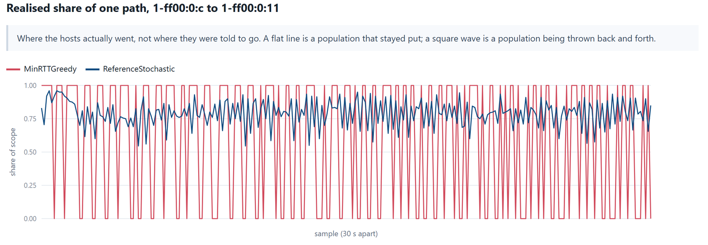
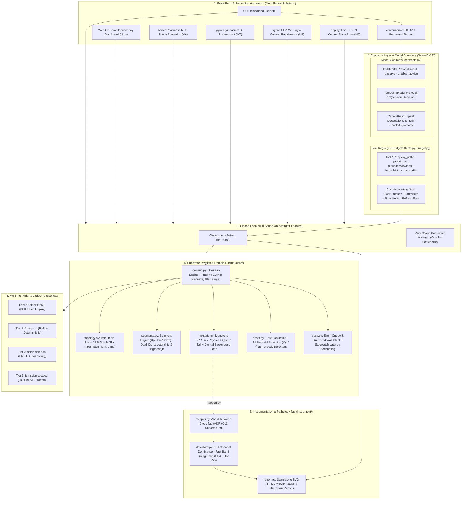

<div align="center">

# scionfit · scionarena

**Conformance and fit checking for SCION path-selection models.**

Existing SCION benchmarks answer *"is your prediction accurate?"*<br>
`scionfit` answers a different question: **"does your model survive being deployed alongside other copies of itself?"**


[](LICENSE)



<sub>A committed run (<a href="docs/evidence/m4-smoke/report.html"><code>docs/evidence/m4-smoke</code></a>: smoke tier, 8 scopes, seed 7). Same world, same scopes, same seed; only the model differs.<br>
<b>Red:</b> a greedy "pick the lowest RTT" model throws its whole population from one path to another and back. <b>Blue:</b> a stochastic model that spreads its advice stays put.</sub>

[Install](#install) · [Use](#use) · [The ten probes](#the-ten-probes) · [Architecture](#system-architecture) · [Status](#status)

</div>

Those are not the same question, and only one of them is currently askable.

---

## The problem this exists for

A path oracle publishes advice. Hosts act on it. Acting on it changes the network. The next round of measurements describes a network that the previous round of advice created.

That means a model can be accurate on recorded data and still be unusable, because accuracy on a fixed dataset says nothing about behaviour in a loop. Concretely: a model that always names the single best path will score well on an offline recommendation benchmark and will cause a stampede in deployment.

`scionfit` probes for that class of defect before you deploy anything.

---

## Install

```bash
pip install -e ".[dev]"
```

No required dependencies. Python 3.11+.

## Use

The package is `scionarena` and conformance is one front-end on it. The `scionfit`
command is kept as an alias for that front-end.

```bash
scionarena conformance list                 # built-in reference models
scionarena conformance check reference      # the compliant reference implementation
scionarena conformance check ema            # the Path Oracle style incumbent
scionarena conformance compare              # every reference model, side by side
scionfit check my.module:MyModel --format markdown --out report.md
```

The closed loop, and the result it exists to produce:

```bash
scionarena ui                                            # a browser, with the knobs
scionarena demo                                          # smoke tier, ~10 s
scionarena demo --tier dev --scopes 40 --slow 8          # add a deliberately slow model
scionarena demo --tier realistic --scopes 100 --cycles 80
```

Two reference models over one scenario, one seed and one set of scopes — nothing differs
but the model — and a self-contained `report.html` of what each did to the network.
Committed runs are in `docs/evidence/`; what they show, and the one criterion they do not
meet, is in `docs/milestones/M3.md`.

In Python:

```python
from scionarena import check
from my_project import MyOracle

card = check(MyOracle(), seed=0, repeats=5)
print(card.to_terminal())
print(card.verdict)  # CONFORMANT | PARTIAL | OPEN-LOOP ONLY | ...
print(card.closed_loop_ready)  # can this be meaningfully stability-tested?
```

## Implement the interface

One class, four methods. A twenty-line moving average can satisfy it; that is a design constraint, not an accident.

```python
from scionarena import Capabilities, Dist, Prediction, Advisory


class MyOracle:
    capabilities = Capabilities(
        name="MyOracle",
        version="0.1",
        distributional=True,  # declare only what you actually do
        demand_conditioned=True,
        emits_assignment=True,
    )

    def reset(self, topo, seed=0): ...
    def observe(self, obs, topo): ...
    def predict(self, topo, paths, horizon_s=0.0, demand=None): ...
    def advise(self, topo, paths, sla, n_hosts=1): ...
```

**Declaring a limitation is free. Declaring a capability you do not have is the one thing scored as worse than failing.** An honest `demand_conditioned=False` gets you `DECLARED_ABSENT` and a note. A false `True` gets you `FALSE_CLAIM`, because a wrong declaration silently corrupts every downstream comparison that trusts it.

---

## The ten probes

Each probe changes exactly one thing and watches what the model does. Probes never compare two models against each other, only one model against itself under a controlled change, which is what makes results portable across model families.

| | Requirement | What the probe actually does |
|---|---|---|
| **R1** | Operates on a graph | Degrades one shared link; checks predictions move for paths using it and not for paths that do not |
| **R2** | Paths are first-class | Builds a path from links you have observed but that was never measured as a unit; asks for a prediction |
| **R3** | Handles sparse, irregular data | Feeds the same metric as *missing* and as *observed zero*; identical output is a failure |
| **R4** | Survives identity churn | *v0.1 tests the wrong thing — see below.* Introduces interfaces that did not exist at reset. Being rewritten: re-signs a path so its identifier changes while its interface sequence does not, and checks the model does not silently discard its history |
| **R5** | Distributional output | Checks for ≥3 ordered quantiles per metric, not a point estimate |
| **R6** | Conditions on demand | Same state, uniform vs 95%-concentrated demand; identical predictions mean the model cannot see its own effect |
| **R7** | Monotone in load | Sweeps demand upward and checks predicted cost never falls |
| **R8** | Emits an assignment | Checks `advise()` returns a distribution rather than a one-hot |
| **R9** | Self-consistent | Takes the advisory, computes the load it induces, re-asks, and measures how far the answer moved |
| **R10** | Degrades with staleness | Withholds observations for 600 s; checks the advisory relaxes and confidence falls |

> **Known defect in v0.1.** R4 was built on the assumption that inter-AS links appear and
> disappear on the timescale of an hour. That is wrong: the physical topology is stable and
> what churns is the *cryptographic material* of a beaconed path segment. The rewritten
> probe is specified in `docs/milestones/M5.md` and the correction in
> `docs/adr/0002-static-links-crypto-churn.md`.

Verdicts: `CONFORMANT`, `PARTIAL`, `OPEN-LOOP ONLY`, `MISDECLARED`, `ERRORED`.

`OPEN-LOOP ONLY` is not an insult. It means the model can be benchmarked on prediction accuracy but not meaningfully on stability, because it cannot represent the effect of its own advice, so a closed-loop test would only restate that fact.

---

## System Architecture

One substrate, several front-ends: conformance, bench, gym, agent and deploy all drive the same closed-loop world.

<details>
<summary><b>Open the architecture diagram</b></summary>



</details>

---

## Where this sits relative to existing work

`scionfit` does not reimplement SCION. It layers on top of tools that already exist and are better at their jobs than anything we would write.

| Tier | Backend | What it gives | Speed |
|---|---|---|---|
| 0 | [ScionPathML](https://arxiv.org/abs/2509.07154) | real SCIONLab measurements, replayed | instant |
| 1 | built in | analytical link model, fully deterministic | ms, thousands of runs |
| 2 | [scion-dqn-sim](https://github.com/netsys-lab/scion-dqn-sim) | BRITE topologies, simulated beaconing | minutes |
| 3 | [ietf-scion-testbed](https://github.com/netsys-lab/ietf-scion-testbed) | a real SCION stack, shaped through `linkd` | hours |

The design goal is that **one scenario definition drives all four tiers.** Tier 3 is what makes that worth doing: `linkd` exposes `tc netem/tbf` over REST, so the same perturbation that degrades a link in the analytical world can degrade a real inter-AS link on real hardware. That makes the sim-to-real gap measurable instead of assumed.

**What each existing tool already does better than us, and which we therefore call rather than copy:** ScionPathML has the real data and the open-loop task definitions. scion-dqn-sim has BRITE topology generation and control-plane beaconing. ietf-scion-testbed has an actual SCION deployment. What none of them has is more than one agent acting on the advice at the same time, which is the only thing `scionfit` adds.

---

## Status

The project grew from the `scionfit` conformance checker (v0.1) into `scionarena`, one simulated SCION substrate with several front-ends. Work follows the milestones in [`docs/milestones/`](docs/milestones/):

| Milestone | State |
|---|---|
| M0 foundation reset, M1 substrate at realistic scale, M2 exposure layer | ✅ Done |
| M3 closed loop (advice changes traffic, traffic changes the next observations) | ✅ Done, one criterion restated (below) |
| M4 instrumentation and pathology detectors | 🚧 In progress: sampling off the world clock is done |
| M5 conformance v2 and later | ⏳ Not started |

**The M3 result.** Two reference models run on one scenario, one seed and one set of scopes, so the only difference is the model. The greedy model throws its whole population from one path to another and back. Its oscillation amplitude is **6 to 19 times** that of the stochastic model, at 4 to 24 concurrent scopes (`docs/evidence/m3-scope-sweep.log`, re-measured in M4 on a fixed 30-second grid). The original pass mark, a spectral "peak dominance" index above 0.5, turned out not to be stable across scale or sample rate. It was replaced by the ratio between the two models, and the milestone notes say so in full.

Still stubbed and not to be trusted: the three external adapters (`docs/ADAPTERS.md`). The type mappings are written, but none has been checked against a live export or a running instance.

The tier-1 world is a deliberately small analytical model, not a packet simulator. It models one thing carefully: cost rises with load, and paths that share a link are coupled.

Related: [MARL_path_selector](https://github.com/HarshaVardhan3002/MARL_path_selector) trains decentralized path-selection policies with MAPPO, the kind of model this harness is built to test.

## Contributing

See `CONTRIBUTING.md`. New probes are welcome and must come with at least one reference model that fails them, because a probe nothing fails is not measuring anything.

## Licence

MIT.

---

## Where this is going

`scionfit` v0.1 is the conformance seed of a larger system, **scionarena**: a harness that
exposes a realistic-scale SCION network to a centrally deployed AI recommendation node,
with raw access, costed tools, a closed loop, and measurement of the AI's own operational
behaviour.

Start with **`CLAUDE.md`**, then **`docs/HANDOFF.md`**, then the milestone you are working
on in `docs/milestones/`.

M0–M3 have landed: the tree is in the target layout and the import direction
(`core <- exposure <- instrument <- {conformance, bench, gym, agent, deploy}`) is enforced
by `lint-imports` in CI rather than by review; the substrate beacons, composes paths and
carries load; models reach it only through costed, rate-limited tools; and the loop is
closed, so advice moves hosts, hosts move link state, and link state moves the next
observation.

```
src/scionarena/
  core/          substrate       (trace hashing only until M1)
  exposure/      contracts       the only thing a model touches
  backends/      tiers 0-3
  conformance/   probes, runner, report card
  reference/     four models, deliberately simple
  instrument/ bench/ gym/ agent/ deploy/     empty until M4-M9
```

Note that `docs/DESIGN.md` describes v0.1 as built. `docs/HANDOFF.md` supersedes it where
they disagree — in particular the churn model, which was wrong in v0.1 and is corrected in
`docs/adr/0002-static-links-crypto-churn.md`.
